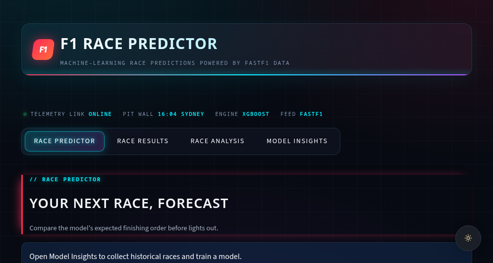

<div align="center">

# 🏎️ F1 PIT WALL

**Fastest-lap telemetry, tyre physics and an XGBoost race-order forecaster, all on one cyberpunk pit-wall dashboard.**

[](https://www.python.org/)
[](https://streamlit.io/)
[](https://xgboost.ai/)
[](https://docs.fastf1.dev/)
[](https://pandas.pydata.org/)
[](https://matplotlib.org/)



</div>

---

## 🧭 Overview

**F1 Pit Wall** is a motorsport analytics platform that turns raw Formula 1 timing data into something an engineer would actually want on the pit wall. It pulls official session data through **FastF1**, lets you put any two drivers head-to-head on their fastest race laps, and layers a **leakage-safe XGBoost model** on top to forecast the finishing order of upcoming Grands Prix.

- 📡 **Telemetry analysis:** speed, throttle, brake, RPM and gear traces aligned by distance around the lap.
- 🛞 **Tyre degradation:** clean-lap pace against tyre age, with fitted trendlines.
- 🗺️ **Track map plotting:** the circuit drawn from X/Y position telemetry for each driver's fastest lap.
- 🤖 **XGBoost prediction:** a recency-weighted model that forecasts the finishing order for an editable entry list.
- 🏁 **Race archive:** official classifications, grid-vs-finish movement, fastest laps and tyre strategies.
- 🎨 **Pit-wall UI:** a glassmorphism dark theme with neon accents, driver portraits and transparent charts.

---

## 🚀 Live Demo

> **[▶ Launch the app on Streamlit Community Cloud](https://f1-predictor-ksktvwe2w7hyqdpldbgb3d.streamlit.app)**

---

## ⚡ Key Features

The dashboard has four pages. **Race Analysis** is the five-tab telemetry workbench, and the **Race Predictor** page is the sixth view.

### 🔬 Race Analysis: two drivers, one circuit
Pick any season from 2018 onwards, a race, and two drivers. Team colours come from FastF1, with dashed lines when teammates share a colour.

| Tab | What you get |
|---|---|
| 📈 **Telemetry** | Five stacked channels (**Speed, Throttle, Brake, RPM, Gear**) from each driver's fastest race lap, aligned by distance from the start line. Brake and gear render as step plots. |
| 🛞 **Tire Degradation** | Lap time against tyre age on clean laps only (pit in/out and inaccurate laps removed). Scatter plus a linear trendline per driver to expose degradation, fuel and traffic effects. |
| 🗺️ **Track Map** | The circuit trace from fastest-lap X/Y position telemetry, with both drivers overlaid on an equal-aspect plot. |
| ⏱️ **Sector Times** | Sector 1/2/3 times from each driver's fastest lap in a styled comparison table. |
| 🌦️ **Weather** | Track and air temperature across the session timeline. |

### 🤖 Race Predictor: XGBoost forecaster
- **Control panel:** choose an upcoming race, review or edit the entry list (add or remove drivers, change teams), then launch the prediction.
- **Podium and full grid:** predicted finishing order shown as driver cards with portraits, team accents and predicted scores. Hover a card for career wins, podiums and age.
- **Export:** download the exact predicted values as CSV.
- **Model insights:** holdout MAE, RMSE and rank MAE, a baseline comparison, and gain-based feature importance.
- **In-app training:** collect historical seasons and retrain from the UI, with tunable feature-decay and training-weight-decay.

**Leakage-safe by design:**
- Rolling 3 and 5 race windows over finishes, qualifying positions, points, DNF rate and grid.
- Team features are aggregated *before* shifting, which prevents teammate leakage.
- Current-race grid, qualifying, lap times, status and results are never direct inputs.
- Recency weighting favours recent form. The holdout season is excluded from fitting, then the model is refit on all history for production.

### 🏁 Race Results: the archive
Season and Grand Prix browser with a podium, full classification cards, positions gained or lost, fastest laps, team performance, actual tyre strategies and lap-by-lap race progression.

---

## 🛠️ Tech Stack

| Layer | Technology |
|---|---|
| Language | **Python 3.11+** |
| Data source | **FastF1**: official timing, telemetry, weather and results, with local HTTP caching |
| Machine learning | **XGBoost**: gradient-boosted ranking-score regression with sample recency weighting |
| Data wrangling | **Pandas**, **NumPy** |
| Visualisation | **Matplotlib**: transparent, dark-mode telemetry plots styled for the glass UI |
| App framework | **Streamlit**: custom CSS, glassmorphism and a responsive dashboard layout |

---

## 💻 Local Installation

```bash
# 1. Clone the repository
git clone https://github.com/<The>/F1-Predictor.git
cd F1-Predictor

# 2. Create and activate a virtual environment
python -m venv venv
source venv/bin/activate          # macOS / Linux
# .\venv\Scripts\Activate.ps1     # Windows (PowerShell)

# 3. Install dependencies
pip install -r requirements.txt

# 4. Launch the dashboard
streamlit run app.py
```

Then open **http://localhost:8501**.

### Train the model

The predictor needs historical data and a trained model. Do it from the **Model Insights** page, or from the CLI:

```bash
python -m src.data_collection --seasons 2023 2024 2025 --no-laps
python -m src.train_model
```

The first collection downloads data over the network and can take several minutes. FastF1 caches it under `data/`, so later runs are fast.

---

## 📂 Project Structure

```
├── app.py                   # Streamlit entry point, pit-wall skin and analysis tabs
├── src/
│   ├── data_collection.py   # FastF1 → historical race dataset
│   ├── features.py          # Leakage-safe rolling and team features
│   ├── train_model.py       # XGBoost training, holdout validation, refit
│   ├── predict.py           # Inference for upcoming races
│   ├── race_results*.py     # Race archive data and page
│   ├── ui_components.py     # Driver cards, headers, model panels
│   └── theme.py             # Design tokens and base theme
├── tests/                   # Pipeline, results and UI tests
└── requirements.txt
```

---

<div align="center">

*Independent analytics project. Not affiliated with Formula 1, the FIA or any team.*
*Built with FastF1 and XGBoost.*

</div>
